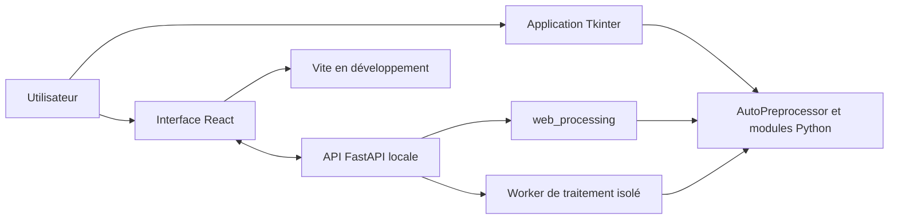

# AutoPrépa

AutoPrépa est un outil local de préparation de jeux de données tabulaires supervisés pour la classification et la régression. Il propose une application de bureau Tkinter, un module Python réutilisable et une interface web locale React/FastAPI.

Les analyses et recommandations sont des aides exploratoires, pas une garantie de qualité statistique ni de performance prédictive. Vérifiez les transformations et les résultats dans le contexte de vos données.

## Fonctionnalités

- Lecture de fichiers CSV, TSV, TXT, XLSX, XLS, JSON et Parquet.
- Analyse descriptive des colonnes et recommandations configurables, avec choix par colonne.
- Nettoyage, détection de types, imputation, traitement des valeurs extrêmes, transformations et mise à l'échelle.
- Encodage des catégories, des dates et du texte; sélection de variables.
- Prétraitement ajusté sur le train puis réutilisé sur le test. Les encodages supervisés du train utilisent des valeurs out-of-fold.
- Aperçu, rapports, export de données transformées et sauvegarde du préprocesseur.
- Évaluation exploratoire par validation croisée, y compris une évaluation imbriquée dans les interfaces qui la proposent.

Le pipeline web ordonne les opérations ainsi: nettoyage et détection de types, traitement des valeurs extrêmes, imputation, transformations de distribution et mise à l'échelle, encodage/extraction des variables, puis sélection finale. Les opérations précises dépendent des types et des choix configurés.

Les recommandations, filtres de fuite et règles métier restent heuristiques. Une alerte ou une absence d'alerte ne prouve pas qu'une variable est valide ou qu'il n'y a pas de fuite.

## Parcours des interfaces

### Application de bureau

Lancer `app_preprocess.py` ouvre l'application Tkinter. Le parcours permet de charger un jeu de données, l'analyser, choisir la cible et les paramètres, exécuter le prétraitement, consulter le rapport et exporter les résultats. Les exports de bureau comprennent notamment `train_transforme.csv`, `test_transforme.csv` lorsqu'un jeu de test est créé, `detail_colonnes.csv`, `rapport_pretraitement.txt` et `preprocesseur.joblib`.

### Application web

Le parcours React comprend six étapes:

1. **Import des données** et définition de la tâche.
2. **Analyse statistique** des distributions, valeurs manquantes et corrélations.
3. **Recommandations** et éléments justificatifs.
4. **Configuration** du pipeline et choix par variable.
5. **Aperçu et traitement** des opérations avant l'exécution.
6. **Export des résultats** et consultation des opérations effectuées.

L'API sert aussi les résultats EDA, l'analyse, l'aperçu, l'évaluation et les téléchargements. Les réponses et formats disponibles sont définis par le code de l'API; ils peuvent évoluer.

Routes principales:

| Route | Rôle |
|---|---|
| `POST /api/upload`, `POST /api/config` | Importer un fichier puis définir le mode, la cible et la tâche. |
| `GET /api/eda/{session_id}` | Consulter le profil exploratoire de la session. |
| `POST /api/analyze`, `POST /api/selection-preview`, `POST /api/preview` | Obtenir les recommandations et prévisualiser une sélection ou une transformation. |
| `POST /api/preprocess` | Exécuter le pipeline et préparer les sorties de la session. |
| `POST /api/evaluate`, `POST /api/evaluate-nested` | Lancer les évaluations proposées par le backend. |
| `GET /api/report/{session_id}`, `GET /api/download/{session_id}/{kind}` | Consulter le rapport et télécharger une sortie disponible. |
| `DELETE /api/session/{session_id}` | Fermer une session. |

## Installation sous Windows

Environnement de référence utilisé pour les validations récentes: Windows AMD64, CPython 3.13.15, Node.js 24.21.0 et npm 11.19.0. Ce sont des versions observées, pas une déclaration de compatibilité pour toute version de Python ou de Node.

Depuis PowerShell, clonez le dépôt puis créez un environnement virtuel:

```powershell
git clone https://github.com/Aymane-A/Auto-Preprocessor.git
Set-Location Auto-Preprocessor
py -3.13 -m venv .venv
.\.venv\Scripts\python.exe -m pip install --upgrade pip
.\.venv\Scripts\python.exe -m pip install -r requirements.txt
```

Lancer l'application de bureau:

```powershell
.\.venv\Scripts\python.exe app_preprocess.py
```

Pour l'API et l'interface web de production, `requirements-web.txt` inclut les dépendances Python de base:

```powershell
.\.venv\Scripts\python.exe -m pip install -r requirements-web.txt
npm --prefix frontend ci
npm --prefix frontend run build
.\.venv\Scripts\python.exe serve.py
```

Ouvrez ensuite <http://127.0.0.1:8000>. Le serveur utilise le build présent dans `frontend/dist`.

Pour développer l'interface avec Vite, démarrez l'API dans un terminal:

```powershell
.\.venv\Scripts\python.exe serve.py
```

Puis, dans un autre terminal à la racine:

```powershell
npm --prefix frontend ci
npm --prefix frontend run dev
```

Ouvrez <http://localhost:5173>. `package-lock.json` permet l'installation npm verrouillée par `npm ci`; les dépendances Python, en revanche, sont déclarées principalement par plages et ne constituent pas un lockfile exact. `requirements.txt` comprend également pytest; il n'existe pas de fichier `requirements-dev.txt` suivi dans le dépôt. XGBoost et LightGBM sont des intégrations optionnelles et ne sont pas installées par les fichiers requirements actuels.

## Utilisation Python

```python
import pandas as pd
from sklearn.model_selection import train_test_split
from auto_preprocessor import AutoPreprocessor

df = pd.read_csv("donnees.csv")
X = df.drop(columns=["cible"])
y = df["cible"]

# Adapter la stratégie de partition au problème (groupes, temps, etc.).
X_train, X_test, y_train, _ = train_test_split(
    X, y, test_size=0.2, random_state=42
)

preprocessor = AutoPreprocessor(task="classification")
X_train_ready = preprocessor.fit_transform(X_train, y_train)
X_test_ready = preprocessor.transform(X_test)
print(preprocessor.report())
```

Choisissez `task="regression"` pour une cible de régression ou `task="auto"` pour laisser le module la déterminer. Les décisions et paramètres sont configurables dans `PreprocessConfig`; `analyze()` permet d'obtenir une analyse sans ajuster le pipeline. Voir [`auto_preprocessor.py`](auto_preprocessor.py) pour l'API et les options prises en charge.

## Architecture



| Zone | Rôle |
|---|---|
| [`auto_preprocessor.py`](auto_preprocessor.py) | Analyse, configuration, ajustement et transformation des données. |
| [`app_preprocess.py`](app_preprocess.py) | Interface de bureau et flux de prétraitement. |
| [`api_server.py`](api_server.py), [`web_processing.py`](web_processing.py) | API locale et orchestration des étapes web. |
| [`web_contracts.py`](web_contracts.py) | Schémas et validation des paramètres exposés par l'API. |
| [`feature_selection.py`](feature_selection.py) | Sélecteurs de variables configurables. |
| [`model_evaluation.py`](model_evaluation.py), [`nested_cv.py`](nested_cv.py) | Comparaisons par validation croisée et évaluation imbriquée. |
| [`resampling.py`](resampling.py), [`statistical_profile.py`](statistical_profile.py) | Méthodes de rééquilibrage et profil statistique. |
| [`frontend/`](frontend/) | Interface React/TypeScript, tests Vitest et configuration Vite. |
| [`tests/`](tests/) | Tests Python unitaires, d'intégration, de régression et scientifiques. |
| [`data/`](data/) | Fichiers CSV de démonstration suivis par Git. |
| [`docs/`](docs/) | Rapports et éléments de preuve historiques; tous ne décrivent pas nécessairement l'état actuel. |

Les scripts d'expérimentation et plusieurs rapports sont restés à la racine. Leur déplacement demanderait de vérifier les imports, chemins relatifs, commandes de lancement et liens entre rapports; ils n'ont pas été regroupés dans cette documentation.

## Tests et validation

Depuis la racine du dépôt:

```powershell
.\.venv\Scripts\python.exe -m pytest --collect-only -q
.\.venv\Scripts\python.exe -m pytest -ra
npm --prefix frontend test
npm --prefix frontend run build
```

Les tests Python sont découverts sous `tests/` conformément à [`pytest.ini`](pytest.ini). Sur un checkout propre, les tests qui dépendent du fichier local non distribué `data/titanic.csv` sont ignorés lorsqu'il est absent; ils s'exécutent si ce fichier est fourni localement. Pour une validation qui exclut ces tests et ne lit pas ce fichier:

```powershell
.\.venv\Scripts\python.exe -m pytest -ra -k "not test_complete_workflow_titanic_consistency and not test_real_titanic_binary_holdout_and_reload and not test_real_titanic_nested_binary_validation"
```

Validation exécutée dans cet environnement (Windows, CPython 3.13.15, pytest 8.0.0): `py -3.13 -m pytest --collect-only -q -p no:cacheprovider` a collecté 594 éléments (code 0). La commande sûre `py -3.13 -m pytest -ra -p no:cacheprovider -k "not test_complete_workflow_titanic_consistency and not test_real_titanic_binary_holdout_and_reload and not test_real_titanic_nested_binary_validation"` a terminé avec le code 0: 591 réussites, 3 tests Titanic désélectionnés, 72 avertissements, en 922,95 s. `PYTHONDONTWRITEBYTECODE=1` était défini durant cette exécution pour éviter les fichiers bytecode. Les avertissements incluaient des dépréciations Starlette/httpx, des avertissements de constantes et de divisions invalides en sélection de variables, ainsi que des avertissements explicites sur les validations croisées de sélecteurs.

Les tests Vitest avaient précédemment 46 réussites et le build de production frontend avait réussi; ils n'ont pas été relancés ici, car aucun fichier frontend n'a changé. Playwright n'a pas été exécuté dans cette tâche.

Un essai focalisé antérieur de `/api/preview` avec `scaling: MINMAX` a reçu une réponse locale 504 après le délai configuré de 120 secondes. Des exécutions ultérieures de la suite n'ont pas reproduit systématiquement cet échec, mais son origine n'a pas été établie de façon concluante. Ne considérez pas ce problème comme résolu sur la seule base de tests ultérieurs réussis.

## Sécurité, données et limites

- `serve.py` écoute sur `127.0.0.1:8000`. L'API n'a pas de mécanisme d'authentification; ne l'exposez pas à un réseau ou à Internet. Les limites de requête et le worker isolé ne constituent pas une frontière de sécurité.
- Les fichiers web sont traités localement dans des dossiers temporaires de session, expirant après 30 minutes d'inactivité. Cela ne constitue pas une garantie de suppression sécurisée.
- Les valeurs par défaut de l'API sont une limite d'import de 200 Mio, une limite mémoire de worker de 2 048 Mio et un délai de 120 secondes. Elles peuvent être configurées avec `AUTOPREP_MAX_TABLE_MB`, `AUTOPREP_WORKER_MB` et `AUTOPREP_TIMEOUT_SECONDS`. Ce sont des garde-fous de ressources, pas une capacité garantie pour tous les fichiers.
- L'application de bureau et l'API ont des limites d'entrée distinctes. Les formats compressés ou textuels peuvent demander bien plus de mémoire une fois analysés.
- Ne chargez jamais un fichier `.joblib` non fiable: son chargement peut exécuter du code. Le worker n'est pas un bac à sable et conserve des accès au système de fichiers et au réseau.
- Les bornes métier, les heuristiques de type, les recommandations et les contrôles de fuite doivent être vérifiés avant une utilisation opérationnelle.
- Les trois CSV de démonstration présents sont `churn_telecom_demo.csv`, `fraud_signal_demo.csv` et `immobilier_demo.csv`. Le dépôt ne fournit pas de preuve de provenance ou de licence de redistribution pour ces données; leur présence ne doit pas être interprétée comme une autorisation de réutilisation. Le fichier Titanic mentionné par certains tests n'est pas une donnée de démonstration suivie.
- Le code du projet est distribué sous licence [MIT](LICENSE). Cette licence ne constitue pas une autorisation de réutiliser les jeux de données ou de redistribuer les dépendances tierces; leur provenance, leurs licences et les obligations applicables doivent être vérifiées séparément.
- Les rapports sous `docs/` et à la racine peuvent contenir des mesures ou conclusions historiques. Vérifiez leur date, leur protocole et leur périmètre avant de les citer comme validation actuelle.

## Contribuer

Les contributions sont les bienvenues via une branche et une pull request. Décrivez le comportement modifié, exécutez les tests pertinents ci-dessus et signalez clairement les cas non exécutés. N'ajoutez pas de secrets, de données personnelles, de jeux privés ou de fichiers générés. Pour tout jeu de données ajouté, documentez sa source et les conditions de réutilisation avant de le proposer.

À ce jour, les consignes de contribution détaillées ne sont pas séparées dans un fichier `CONTRIBUTING.md`.
